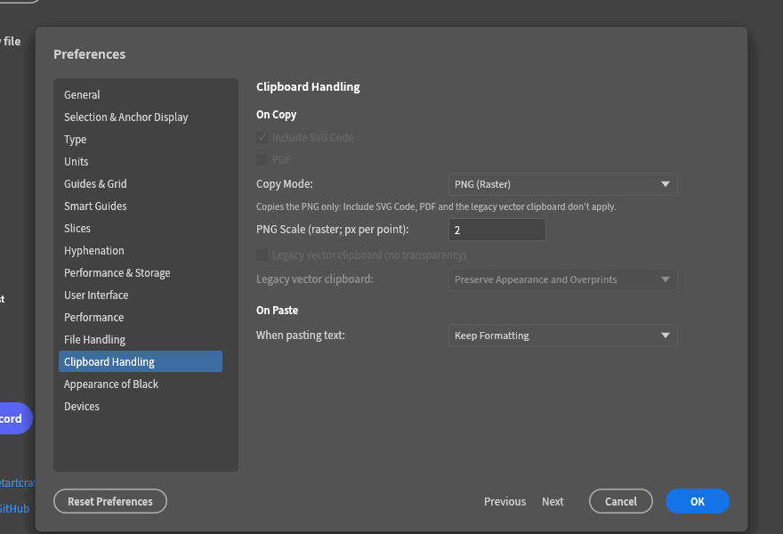
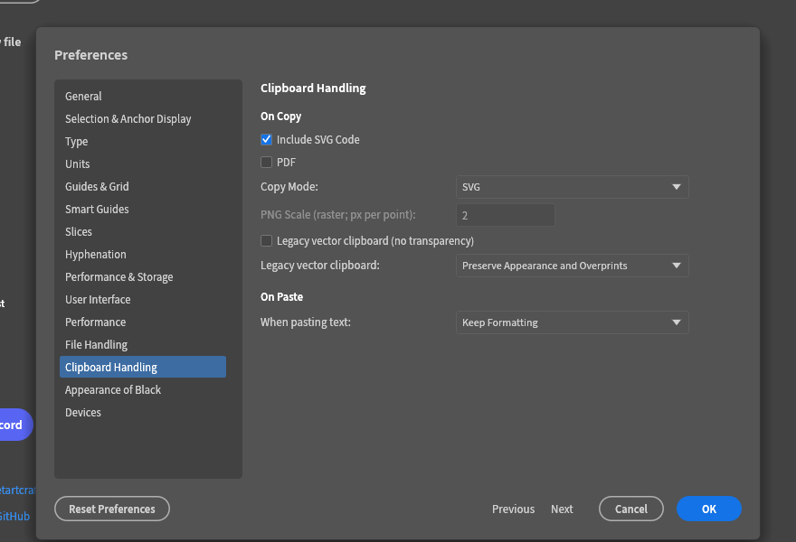
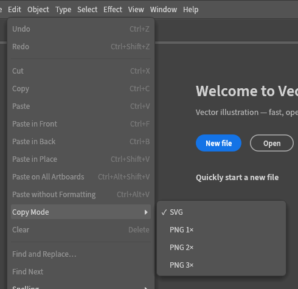

<h1 align="center">VectorCraft — research fork</h1>

  A fork of <a href="https://github.com/storytold/vectorcraft">storytold/vectorcraft</a>, kept only as a
  case study for <b>software-engineering research and teaching on AI agentic coding</b>.

---

## Notice

This repository is a **clone of an existing project**, published solely for the purpose of
**showcasing in the context of software-engineering (SE) research and teaching on AI agentic
coding**. Please read the following before using anything here.

- **Not a contribution channel.** This fork **is not intended to provide contributions** to the
  original project. Nothing here is submitted upstream, and no-one should treat it as a proposed
  change to the original work. It exists to be observed and analysed.
- **No responsibility.** **I take no responsibility for the contents of this repository.** It is an
  unmodified-or-lightly-modified copy of someone else's work, published for study. There is no
  warranty of correctness, fitness, security or legality, and no support is offered.
- **Basis for analysis.** The research analysis of this repository rests **purely on the fact that
  the source is presently public**. If, for legal reasons, the person responsible for the original
  upload has to remove it, **this repository will be removed automatically as well.** It is a mirror
  of that work and has no independent life once the original is withdrawn.
- **Claims are the original project's.** Descriptions of VectorCraft below come from its own
  documentation and code — including its characterisation of itself as a "clean-room" reimplementation
  of Adobe Illustrator — and are reported here **with reservations**, as claims, not as facts this
  repository has verified or endorses. Read the upstream repository itself before relying on any of
  them.
- **Not affiliated.** This fork is not affiliated with, endorsed by, or maintained in cooperation
  with the original authors or the ArtCraft project. Names, logos and trademarks belong to their
  owners.

If you are the original author and want this mirror gone, open an issue on this repository (or
contact its owner) and it will be deleted.

---

## What is VectorCraft?

VectorCraft is an open-source vector illustration application written in Rust. It runs natively on
macOS, Windows, Linux and FreeBSD and in the browser via WebAssembly, and is developed upstream at
[storytold/vectorcraft](https://github.com/storytold/vectorcraft) — its documentation, roadmap,
issues and community live there. **This repository only mirrors it for study.**

**Read with grains of salt.** The original project describes itself as a "clean-room" reimplementation
of the Adobe Illustrator workflow, free of Adobe assets and measured for parity against Adobe's
documentation. Those are the upstream project's own claims about its own work; this repository
neither verifies nor endorses them, and nothing here should be read as confirming them. What can be
checked directly is the code and its tests, which are public in the upstream repository.

The upstream repository states a licence of **MIT OR Apache-2.0**
([`LICENSE-MIT`](LICENSE-MIT), [`LICENSE-APACHE`](LICENSE-APACHE), [`NOTICE`](NOTICE)); those files
carry over unchanged in this copy.

## Local change studied here: "Copy Mode"

This fork additionally carries a small, self-contained change used as the subject of the study:
a clipboard **Copy Mode**. It is a local patch and **is not an upstream contribution**.

**What it does**

- Clipboard Handling ▸ On Copy gains **Copy Mode**: `svg` (the default, the project's existing
  behaviour) or `raster`.
- In **raster** mode, Copy puts a **PNG only** on the clipboard, rasterized at a chosen **PNG
  Scale** of **1×, 2× or 3×** pixels per point (into memory; no file is written).
- In **svg** mode nothing changes: the clipboard carries the SVG/PDF/text flavours the existing
  `Include SVG Code` and `PDF` options select (plus the usual PNG). SVG is resolution independent,
  so the PNG Scale does not apply to it and the field is disabled in that mode.
- **The existing On Copy options remain meaningful.** Because mixing flavours on one clipboard can
  lose the image payload (the receiving application may pick the vector or text flavour), raster
  mode is deliberately **PNG-only**: while it is selected, `Include SVG Code`, `PDF` and the
  `Legacy vector clipboard` options are greyed out in Preferences, with a note saying they don't
  apply.
- A raster that would exceed the renderer's limits is **refused with a dialog** telling the user to
  lower the scale, rather than being silently downscaled.
- The mode is reachable from **Edit ▸ Copy Mode** (a radio group) as well as from Preferences, and
  through the command channel (`prefs.set copyMode` / `copyRasterScale`).

**Where the change lives** (for readers following the study):

| Area | Files |
|---|---|
| Preferences | `crates/engine/src/cmd/prefscmds.rs`, `crates/engine/src/lib.rs`, `crates/ui-egui/src/prefs_dialog.rs` |
| Clipboard flavours | `crates/engine/src/cmd/clipboard/flavours.rs` |
| UI command and menu | `crates/ui-egui/src/menus.rs`, `crates/ui-egui/src/sysclip.rs` |
| Tests | `crates/engine/src/tests_clipflavours.rs`, `crates/ui-egui/src/tests_sysclip.rs` |
| Translations | `crates/ui-egui/src/i18n/*.tsv` |

### Screenshots

The Preferences ▸ Clipboard Handling ▸ On Copy panel, with Copy Mode set to **PNG (Raster)** —
`PNG Scale` active, the vector options greyed out and the note explaining why:

Copy Mode set to **SVG** — the vector options active again and `PNG Scale` greyed out:

The Edit menu's Copy Mode radio group:

## Licence and credits

The code, artwork and documentation here are the work of the upstream project's contributors and the
ArtCraft team; its repository states a licence of **MIT OR Apache-2.0**
([`LICENSE-MIT`](LICENSE-MIT), [`LICENSE-APACHE`](LICENSE-APACHE), [`NOTICE`](NOTICE),
[`ASSETS.md`](ASSETS.md)), and states that the ArtCraft name, wordmark and logos in `docs/brand/`
are trademarks and not open source
([`docs/brand/LICENSE-brand.txt`](docs/brand/LICENSE-brand.txt)). Those files and statements carry
over unchanged in this copy.

This fork adds only the documentation you are reading, the Copy Mode patch described above, and —
where screenshots are provided — captures of the running application for the study. No rights beyond
those the upstream project grants are claimed.
